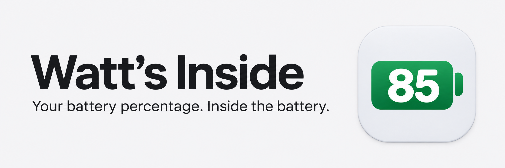
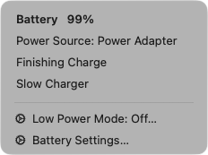

# Watt’s Inside



A small, native macOS app that puts your battery percentage inside the menu-bar icon. More room for everything else.

Built with Swift, AppKit, and IOKit. No dependencies, analytics, network requests, polling timers, Dock icon, or background helper.

[Latest release](https://github.com/jcb79107/watts-inside/releases/latest) · [Build from source](#install) · [MIT license](LICENSE)

## Small icon. Familiar menu.

Click for your battery level, power source, charging status, and Battery Settings. The number stays inside the icon; a bolt appears while charging. Native template rendering follows your menu-bar appearance.



- **Charging status:** charging, finishing, full, low battery, or not charging.
- **Charge holds and limits:** see when macOS pauses charging or reaches your configured limit.
- **Slow Charger:** uses the same system signal as Apple’s menu, without guessing from wattage.
- **Charge to Full Now:** temporarily override an eligible hold or limit, then restore your saved limit.
- **Useful details:** time until full and battery-health notices when macOS provides them.
- **Low Power Mode:** see its status and open Battery Settings to change it.

Right-click or Control-click to quit. Command-drag to reposition the icon. Unknown battery data displays `?` instead of an invented percentage.

The menu is built with AppKit. Apple’s significant-energy app list is not included.

## Less space. Little overhead.

In a live comparison at 99% charging, Watt’s Inside occupied **59 pt** of menu-bar width versus **71 pt** for Apple’s battery plus percentage—**17% less**, including system padding. Width varies with the number and charging indicator.

A twenty-minute installed-app idle test of **1.1.10** averaged **0.072% CPU**, with **16–18 MB memory** (17 MB in 113 of 121 samples). Usage stayed low, though higher than the earlier build’s measurements under different conditions. These are measurements from one Mac, not a battery-life or zero-leak guarantee.

[Width and menu verification](docs/slow-charger-and-menu.md) · [Idle measurements and limitations](docs/idle-measurement.md)

## Install

Requires macOS 13 or newer and Xcode Command Line Tools with Swift 6 or newer. Source builds are the supported installation path and target your Mac’s architecture.

```sh
git clone https://github.com/jcb79107/watts-inside.git
cd watts-inside
./test.sh
./build.sh
open "build/Watt’s Inside.app"
```

1. Move **Watt’s Inside.app** from `build/` to Applications.
2. Hide Apple’s battery icon in **System Settings → Menu Bar** (Control Center on older macOS).
3. For automatic startup, add Watt’s Inside in **System Settings → General → Login Items**.

Release downloads are ad-hoc signed, not Developer ID signed or notarized. Gatekeeper may block downloaded builds; building from source is recommended. Do not disable Gatekeeper globally.

**Using Ice?** If an old unnamed item is cached, quit and reopen Ice, then move Watt’s Inside from Hidden to Visible in Menu Bar Layout. Verified with Ice 0.11.13-dev.2.

## Charging controls and compatibility

macOS controls charging. Charge to Full Now appears only when the system reports an eligible hold or limit and allows the action. The app saves your exact charge limit before overriding it and verifies restoration before clearing that recovery record. Failed restoration keeps a visible retry action.

**The app must be running to restore automatically.** After a force-quit, recovery resumes when you reopen it. Before uninstalling, choose **Restore** if shown, then quit normally.

Charging controls and Slow Charger reporting use private macOS interfaces, which can change in future updates. Unsupported or unknown states omit the relevant feature. Core percentage reporting uses IOKit. This app is not intended for Mac App Store submission.

[Charging behavior, recovery, and known limits](docs/charge-to-full.md) · [Tests and device coverage](docs/verification.md)

## Development

Run `./test.sh` for parsing, state, charging-recovery, notification, and icon-width checks. Run `./build.sh` to create the app. No package manager is needed.

Changes that keep the app small are welcome. The charging adapter is adapted from [Lithe](https://github.com/asmeurer/Lithe); see [third-party notices](THIRD_PARTY_NOTICES.md). Licensed under [MIT](LICENSE).

## Brand assets

The graphite-on-silver app icon, colors, typography, and usage notes live in the [brand guide](docs/brand.md). Download the [icon PNG](https://github.com/jcb79107/watts-inside/releases/latest/download/AppIcon.png) or [banner](https://github.com/jcb79107/watts-inside/releases/latest/download/readme-banner.png) from the latest release. With full Xcode installed, rebuild the bundled ICNS and asset catalog from the master PNG by running `./scripts/build-icons.sh` before `./build.sh`.
